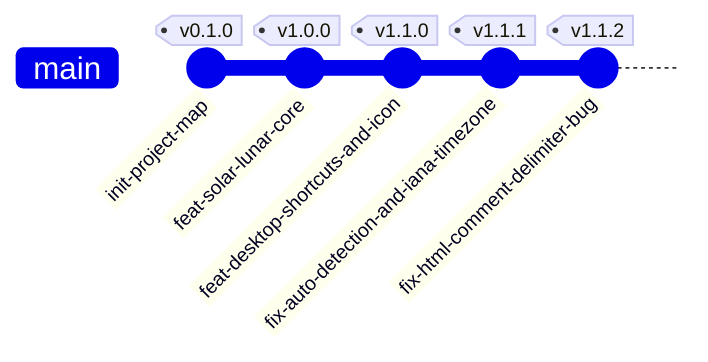

# Solarium: Reloj Solar Local & Calendario Fijo de 13 Meses - Project Map

Aplicación web astronómica y cronobiológica standalone, 100% offline y sin dependencias externas, que sincroniza el tiempo humano con el cosmos y la naturaleza a través de dos pilares:
1. **Reloj Solar Local Verdadero (LAST)** anclado al mediodía solar local mediante corrección de longitud y la Ecuación del Tiempo ($E_oT$).
2. **Calendario Fijo Internacional de 13 Meses de 28 Días** (incluyendo el mes central *Sol* y el *Year Day*), integrado con rastreador de fases lunares en tiempo real y sincronización de ritmos biológicos/circadianos.

---

## 📊 Grafo de Versiones

---

## 📌 Checkpoints

| ID | Fecha | Versión | Descripción | Estado |
|---|---|---|---|---|
| `CHK-001` | 2026-10-23 | `v0.1.0` | Inicialización del repositorio git y mapa del proyecto | ✅ Completado |
| `CHK-002` | 2026-10-23 | `v1.0.0` | Aplicación interactiva completa (`index.html`) con Reloj Solar Local Verdadero, simulador de bóveda celeste, Calendario de 13 meses de 28 días perpetuo, calculador lunar astronómico, guía de fases biológicas y scripts desacoplados POSIX `start.sh`/`stop.sh` en puerto asignado `5195` | ✅ Completado |
| `CHK-003` | 2026-10-23 | `v1.1.0` | Creación de lanzadores en el Escritorio: aplicación nativa compilada macOS `Solarium.app` con icono personalizado de sol y luna dorada/plateada (`.icns`), lanzador por terminal `Solarium.command` y script desacoplado `launch-desktop.sh` | ✅ Completado |
| `CHK-004` | 2026-10-23 | `v1.1.1` | Corrección integral del motor de detección: resolución de syntax error en el cierre del script, integración de base de datos de zonas horarias IANA con auto-detección instantánea (0 ms, 100% offline, detectando automáticamente Mérida / Yucatán `America/Merida`), barra visual de ubicación activa con indicador de pulso en vivo, refinamiento por IP en segundo plano, soporte para Secure Context en `launch-desktop.sh` vía `http://127.0.0.1:5195` y manejo defensivo del botón GPS | ✅ Completado |
| `CHK-005` | 2026-10-23 | `v1.1.2` | Corrección del delimitador de comentario HTML previo al bloque `<script>`: se corrigió `*/` por `-->` en la cabecera del script que causaba que el parser HTML del navegador tratara todo el código JavaScript como un comentario HTML no cerrado, impidiendo su ejecución. Verificado con WebKit nativo en vivo | ✅ Completado |

---

## 🚦 Estado de la Sesión
- **Estado Actual:** Solarium 100% operativo en `http://127.0.0.1:5195` y verificado en tiempo real con WebKit. Mérida, Yucatán (`America/Merida`) y los 28 días del mes activo se renderizan inmediatamente al cargar.
- **Siguiente paso:** Confirmación del usuario y disfrute de la aplicación.
