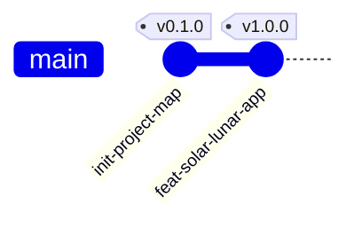

# Solarium: Reloj Solar Local & Calendario Fijo de 13 Meses - Project Map

Aplicación web astronómica y cronobiológica standalone, 100% offline y sin dependencias externas, que sincroniza el tiempo humano con el cosmos y la naturaleza a través de dos pilares:
1. **Reloj Solar Local Verdadero (LAST)** anclado al mediodía solar local mediante corrección de longitud y la Ecuación del Tiempo ($E_oT$).
2. **Calendario Fijo Internacional de 13 Meses de 28 Días** (incluyendo el mes central *Sol* y el *Year Day*), integrado con rastreador de fases lunares en tiempo real y sincronización de ritmos biológicos/circadianos.

---

## 📊 Grafo de Versiones

---

## 📌 Checkpoints

| ID | Fecha | Versión | Descripción | Estado |
|---|---|---|---|---|
| `CHK-001` | 2026-10-23 | `v0.1.0` | Inicialización del repositorio git y mapa del proyecto | ✅ Completado |
| `CHK-002` | 2026-10-23 | `v1.0.0` | Aplicación interactiva completa (`index.html`) con Reloj Solar Local Verdadero, simulador de bóveda celeste, Calendario de 13 meses de 28 días perpetuo, calculador lunar astronómico, guía de fases biológicas y scripts desacoplados POSIX `start.sh`/`stop.sh` en puerto asignado `5195` | 🟡 En progreso |

---

## 🚦 Estado de la Sesión
- **En progreso:** Desarrollo de la aplicación en `/Users/joe/Developer/reloj-solar-13meses/index.html`.
- **Siguiente paso:** Pruebas matemáticas astronómicas, verificación de precisión solar/lunar y pruebas Zero-Defect.
